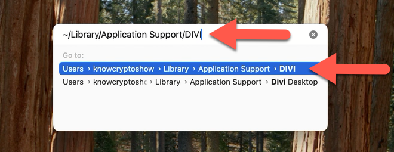
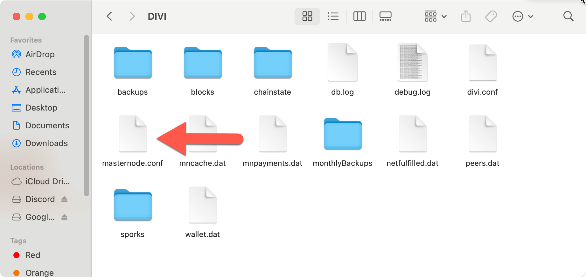

# macOS: Safely Dismantle a Legacy Masternode

This guide explains how to remove leftover masternode configuration from Divi Desktop on macOS.

> **Warning:** The `DIVI` folder contains critical wallet files such as `wallet.dat`.  
> **Only delete `masternode.conf`.** Do not change or delete anything else.

### Keep These Tutorials Going

These tutorials are freely shared to help others learn, solve problems, and pass that knowledge on.

**[If this helped you, consider supporting the work and helping keep these tutorials going →](https://thevoice.dev/#donations)**

---

## Steps

### 1. Close the Divi Desktop Application Properly

- Click the **X** in the top-left corner of the Divi Desktop application.
- When prompted, select **Exit (Close app)** instead of Minimize.
- Wait until the application has completely exited. **Do not continue until it has fully closed.**

### 2. Open the DIVI Folder in Finder

- Press **Command (⌘) + Shift + G** to open the **Go to Folder** dialog.
- Type or paste the following path, then press **Enter**:

```
~/Library/Application Support/DIVI
```



This opens the DIVI directory in your macOS Library.

### 3. Locate the `masternode.conf` File

- In the Finder window that opens, look for the file named **masternode.conf**.

### 4. Delete the `masternode.conf` File

- Right-click (or Control-click) **masternode.conf** and select **Move to Trash**.
- Confirm it has been moved to the Trash.
- Close the Finder window.



### 5. Reopen Divi Desktop

- Open the Divi Desktop application.
- Allow it to fully sync with the blockchain.
- Once synced, your **Total** and **Spendable** balances will match.

### Keep These Tutorials Going

These tutorials are freely shared to help others learn, solve problems, and pass that knowledge on.

**[If this helped you, consider supporting the work and helping keep these tutorials going →](https://thevoice.dev/#donations)**

---

## Important warnings

- Be careful in the **DIVI** directory.
- The DIVI folder contains **critical wallet files** like `wallet.dat`.
- Altering or deleting those files may cause wallet issues or loss of access to your funds.
- **Only delete the `masternode.conf` file as instructed.**
- Avoid experimenting with or altering any other files.
