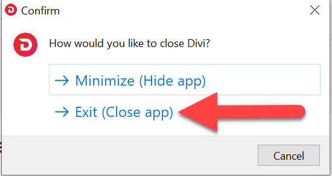
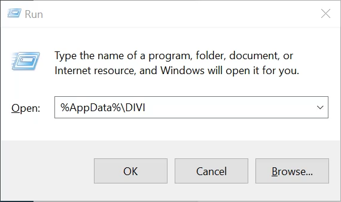
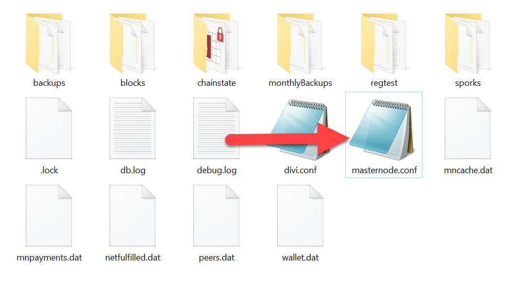

# Windows: Safely Dismantle a Legacy Masternode

This guide explains how to remove leftover masternode configuration from Divi Desktop on Windows.

> **Warning:** The `DIVI` folder contains critical wallet files such as `wallet.dat`.  
> **Only delete `masternode.conf`.** Do not change or delete anything else.

### Keep These Tutorials Going

These tutorials are freely shared to help others learn, solve problems, and pass that knowledge on.

**[If this helped you, consider supporting the work and helping keep these tutorials going →](https://thevoice.dev/#donations)**

---

## Steps

### 1. Close the Divi Desktop Application Properly

- Click the **X** in the top-right corner of the Divi Desktop application.
- When prompted, select **Exit (Close app)** instead of Minimize.
- Wait until the application has completely exited before continuing.



### 2. Open the DIVI Folder in File Explorer

- Press `Win + R` to open the **Run** dialog box.
- Type or paste the following command, then press **Enter** or click **OK**:

```
%AppData%\DIVI
```



This opens the Divi directory at `AppData\Roaming\DIVI`.

### 3. Locate the `masternode.conf` File

- In the window that opens, look for the file named `masternode.conf`.

### 4. Delete the `masternode.conf` File

- Right-click `masternode.conf` and select **Delete**.
- Confirm the deletion so it is sent to the Recycle Bin.
- Close File Explorer.



### 5. Open Divi Desktop

1. Open the Divi Desktop application.
2. Allow it to fully sync with the blockchain.
3. Once synced, your **Total** and **Spendable** balances will match.

### Keep These Tutorials Going

These tutorials are freely shared to help others learn, solve problems, and pass that knowledge on.

**[If this helped you, consider supporting the work and helping keep these tutorials going →](https://thevoice.dev/#donations)**

---

## Important warnings

- Be careful in the **DIVI** directory.
- The DIVI folder contains critical wallet files like `wallet.dat`.
- Altering or deleting those files may cause wallet issues or loss of access to your funds.
- **Only delete the `masternode.conf` file as instructed.**
- Avoid experimenting with or altering any other files.
